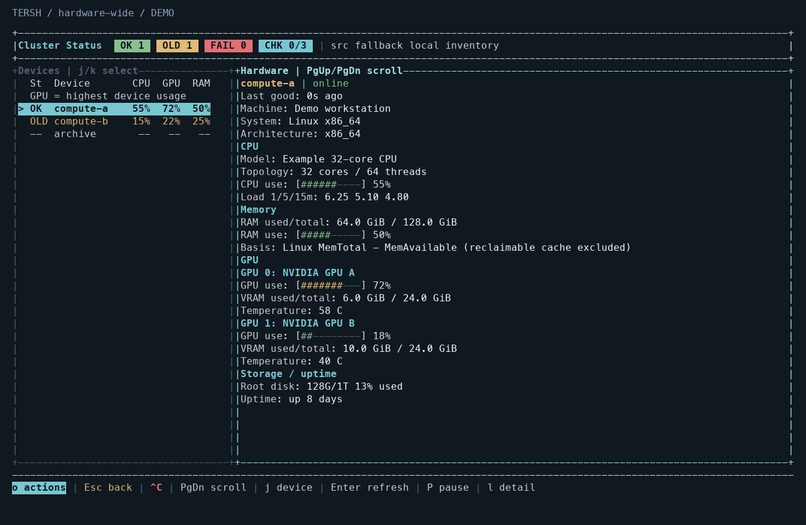

# Hardware manager / 硬件管理器

Open `tersh --c` and press `H`. The hardware page uses the configured devices
and the dashboard's existing refresh cycle (15 seconds by default, with failure
backoff). It does not require Tersh on each remote host; the existing SSH probe
runs read-only system commands. No agent, root access or package installation is
required. CPU collection adds an approximately one-second sampling window to
each probe, inside the existing 30-second deadline and concurrency limit.

| Action | Default key |
| --- | --- |
| Open hardware manager | `H`, or `o` and search `hardware` / `硬件` |
| Select previous / next device | `k` / `j`, or Up / Down |
| Scroll hardware information | PageUp / PageDown |
| Refresh selected device / all devices | Enter / `r` |
| Pause automatic refresh | `P` |
| Return to host list | `q` or Esc |

Wide terminals show a device summary beside the selected device. `GPU` in this
summary is the highest **reported** GPU utilization on that device; inspect the
individual GPU rows for missing counters. `OLD` labels retained readings after
failure, `CHK` marks an active check, and `ERR` means no usable retained result.
The selected device shows the last successful observation's age and any probe
error. At narrow widths, the hardware page fills the screen; scrolling accounts
for wrapped names and the available terminal height.

## Readings and limits

| Metric | Source and meaning |
| --- | --- |
| Device / CPU model, architecture, physical cores, logical threads | macOS `sysctl`; Linux `/proc/cpuinfo`, `getconf` and available DMI fields. Missing physical topology stays unknown. |
| CPU use | Linux aggregate `/proc/stat` differences over one second, excluding idle and I/O wait and not double-counting guest time. macOS uses the second `top` interval and subtracts idle. Rounded to a whole percentage. Load averages remain a separate metric. |
| Linux RAM used / total | `MemTotal - MemAvailable` from `/proc/meminfo`; reclaimable cache is excluded. Missing `MemAvailable` leaves used memory unknown. |
| macOS RAM occupied / total | `hw.memsize` minus free and speculative pages from `vm_stat`. Includes caches and is **not memory pressure** or Activity Monitor's application-memory measure. The page labels this basis. The existing dashboard memory-pressure summary is retained separately. |
| NVIDIA GPUs | One `nvidia-smi` query returns each GPU's name, utilization, used/total VRAM and temperature. `[N/A]` counters stay unknown. WSL's usual NVIDIA executable directory is included in the probe path. |
| Apple GPUs | `IOAccelerator` model and driver counters from `ioreg`; display inventory falls back to `system_profiler`. Shared RAM is labeled separately and never presented as dedicated VRAM. Temperature is unknown unless supported by the collector. |
| Other Linux GPUs | DRM devices supply vendor/device identity, optionally a name from `lspci`, and utilization/VRAM when exposed by the driver. Intel GPU utilization commonly remains unknown. Mixed NVIDIA/Intel/AMD devices are retained without duplicating NVIDIA DRM entries. Unidentified display nodes, such as WSL's virtual `vgem`, are not counted as additional physical GPUs. |

All capacities use bytes internally and display MiB/GiB. Zero is shown only
when measured; absent tools, denied access, invalid ranges and unsupported
driver counters show `unknown`. A GPU model or missing tool does not establish
that the host has no GPU. Up to 64 GPU records are retained per probe.

VMs, containers and WSL report the hardware and counters visible to that
environment. These readings do not establish scheduler allocations, quotas or
availability for a new job. Native Windows probing is not implemented.

## 中文

在 `tersh --c` 中按 `H` 查看硬件。可看到设备与 CPU 型号、核心/线程数、CPU
使用率、内存容量与占用，以及每块 GPU 的型号、利用率、显存和可用温度数据。
`j`/`k` 切换设备，PageUp/PageDown 翻页，Enter 刷新当前设备，`P` 暂停自动刷新，
`q` 返回主机列表。也可以在 `o` 操作菜单中搜索“硬件”。

Linux 内存使用量排除可回收缓存；macOS 显示包含缓存的物理内存占用，不能将其
等同于内存压力。Apple GPU 使用共享内存，不会虚构独立显存容量。驱动没有提供的
读数显示 `unknown`；刷新失败会标记旧数据及其时间。远端数据通过已有 SSH 配置
采集，无需安装常驻代理。
